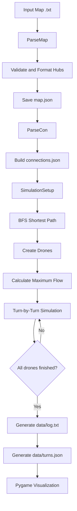
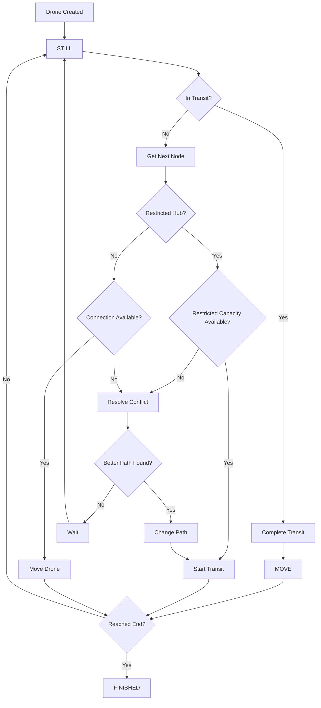

*This project has been created as part of the 42 curriculum by albben-a.*

# Fly-In

## Table of Contents

1. [Description](#description)
2. [Algorithmic Architecture](#algorithmic-architecture)

   * [Map Representation](#map-representation)
   * [Pathfinding with BFS](#pathfinding-with-bfs)
   * [Capacity and Maximum Flow](#capacity-and-maximum-flow)
   * [Conflict Resolution](#conflict-resolution)
   * [Discrete-Time Simulation](#discrete-time-simulation)
3. [System Flowcharts](#system-flowcharts)

   * [Overall System Flow](#overall-system-flow)
   * [Drone State Flow](#drone-state-flow)
4. [Visual Representation](#visual-representation)
5. [Project Structure](#project-structure)
6. [Instructions](#instructions)

   * [Prerequisites](#prerequisites)
   * [Installation](#installation)
   * [Execution](#execution)
   * [Makefile Commands](#makefile-commands)
7. [Input & Output Examples](#input--output-examples)

   * [Input Map](#input-map)
   * [Output](#output)
8. [Resources & AI Usage](#resources--ai-usage)

---

## Description

**Fly-In** is a Python-based drone swarm simulation that calculates routes for multiple drones travelling through a network of interconnected hubs.

The project combines graph traversal, capacity management and a turn-based simulation. Each drone receives a path from the starting hub to the destination and adapts its route when a connection or restricted hub becomes unavailable.

The main objectives are:

* Calculate a valid path from `start` to `end`.
* Handle blocked and restricted hubs.
* Respect connection and hub capacity constraints.
* Detect conflicts between drones.
* Recalculate paths when a conflict occurs.
* Simulate drone movements turn by turn.
* Save the resulting movements to text and JSON files.
* Provide a graphical representation of the simulation using **Pygame**.

The project is divided into three main stages:

```text
Input Map
    │
    ▼
Parsing & Validation
    │
    ▼
Graph Construction
    │
    ▼
Pathfinding & Simulation
    │
    ▼
Movement Results
    │
    ├──────────────► data/log.txt
    │
    ├──────────────► data/turns.json
    │
    ▼
Pygame Visualization
```

---

# Algorithmic Architecture

## Map Representation

The map is represented as a graph:

* **Hubs** are the nodes of the graph.
* **Connections** are the edges between hubs.
* Each hub has coordinates, a zone type, a color and a maximum number of drones.
* Each connection has a maximum link capacity.

The parser first converts the input `.txt` file into structured data stored in:

* `data/map.json`
* `data/connections.json`

The adjacency list stored in `connections.json` allows the pathfinding algorithm to efficiently access the neighbours of each hub.

For example:

```json
{
    "start": [
        "waypoint1"
    ],
    "waypoint1": [
        "start",
        "waypoint2"
    ],
    "waypoint2": [
        "waypoint1",
        "end"
    ],
    "end": [
        "waypoint2"
    ]
}
```

This representation is convenient for graph traversal because every node directly contains the nodes that can be reached from it.

---

## Pathfinding with BFS

The project uses **Breadth-First Search (BFS)** to find a path between the current position of a drone and the destination.

BFS explores the graph level by level and therefore finds the shortest path in terms of number of connections in an unweighted graph.

The algorithm also takes into account:

* Blocked hubs.
* Temporarily blocked hubs.
* Blocked connections.
* Restricted zones.

The pathfinding process is:

```text
Start
  │
  ▼
Create BFS Queue
  │
  ▼
Take first path from queue
  │
  ▼
Is current node "end"?
  │
  ├── YES ──► Calculate path cost ──► Return path
  │
  └── NO
       │
       ▼
    Get neighbours
       │
       ▼
    Filter:
    - visited nodes
    - blocked hubs
    - blocked connections
       │
       ▼
    Add valid paths to queue
       │
       └──────────────► Repeat
```

### Path Cost

After BFS finds a path, the simulation calculates its movement cost.

* Normal, priority and other accessible hubs cost **1 turn** to enter.
* A `restricted` hub costs **2 turns**.
* A `blocked` hub cannot be used.

For example, a path containing:

```text
start → hub1 → restricted → end
```

has a cost of:

```text
1 + 1 + 2 = 4 turns
```

The calculated cost is stored in each `Drone` object and is later used when deciding whether a new route is better than waiting.

---

## Capacity and Maximum Flow

Before starting the simulation, the program calculates the maximum number of drones that can be handled simultaneously.

The value is determined by the smallest capacity found among:

* The total number of drones.
* Hub capacities (`max_drones`).
* Connection capacities (`max_link_capacity`).

Conceptually:

```text
Maximum Flow
     │
     ├── Number of drones
     │
     ├── Hub capacities
     │
     └── Connection capacities
             │
             ▼
      Minimum capacity
             │
             ▼
       Maximum Flow
```

This value is stored in `StateMachine.max_flow`.

The same value is used when checking whether a connection or restricted hub can accept another drone during the current simulation turn.

---

## Conflict Resolution

Drones can encounter conflicts when several of them try to use the same resource during the same turn.

Two main types of conflict are handled.

### Connection Conflict

A connection is considered unavailable when its current usage reaches `max_flow`.

When this happens, the program attempts to find another path while temporarily blocking the conflicting connection.

```text
Drone wants to move
        │
        ▼
Is connection available?
     │          │
    YES         NO
     │          │
     ▼          ▼
   Move      Recalculate path
                 │
                 ▼
          Is new path cheaper
             than waiting?
              │       │
             YES      NO
              │       │
              ▼       ▼
        Change path   Wait
```

### Restricted Hub Conflict

Restricted hubs require an additional turn of transit and have capacity restrictions.

Before entering a restricted hub, the simulation checks:

* Current drones occupying the hub.
* Drones leaving the hub.
* Drones currently travelling towards it.
* The maximum allowed capacity.

If the hub is full, the program tries to calculate an alternative route avoiding that hub.

---

## Discrete-Time Simulation

The simulation is executed one turn at a time.

Every drone has a state represented by the `Move` enum:

```text
still    = 0
connect  = 1
move     = 2
```

The `Drone` class stores:

* Drone ID.
* Current position.
* Planned path.
* Current path cost.
* Number of waiting turns.
* Finished status.
* Current movement state.
* Transit state.
* Transit target.

A restricted movement is handled as a two-step operation:

```text
Current Hub
    │
    ▼
Start Transit
    │
    │  restricted movement
    ▼
Complete Transit
    │
    ▼
Restricted Hub
```

This allows the simulation to represent restricted zones as movements that take more than one turn.

---

# System Flowcharts

## Overall System Flow

The complete application follows this pipeline:



### Application Flow

1. The input map is parsed and validated.
2. Hub information is stored in `map.json`.
3. Connections are converted into an adjacency list.
4. BFS calculates the initial path.
5. The drones are created using this path.
6. The maximum flow is calculated from the map capacities.
7. The simulation starts.
8. Every turn processes each unfinished drone.
9. Conflicts trigger alternative path calculations.
10. Results are written to `log.txt` and `turns.json`.
11. Pygame loads the generated data and displays the simulation.

---

## Drone State Flow

The state of an individual drone is managed independently during the simulation.



The important idea is that a blocked drone does not automatically change its route. A new route is only accepted when its calculated cost is lower than the cost of waiting for another turn.

---

# Visual Representation

The simulation results are displayed using **Pygame**.

The graphical interface loads:

* `data/map.json`
* `data/connections.json`
* `data/turns.json`

The map is rendered dynamically from the hub coordinates.

### Visual Elements

* **Hubs** are displayed as circles.
* **Connections** are displayed as lines.
* **Drones** are displayed as moving graphical objects.
* Hub colors come from the map configuration.
* Special `rainbow` hub colors are animated.
* Drone movement is interpolated to create a smoother visualization.

The window also provides basic controls:

| Key     | Action             |
| ------- | ------------------ |
| `SPACE` | Pause / Resume     |
| `R`     | Restart simulation |
| `←`     | Previous turn      |
| `→`     | Next turn          |
| `ESC`   | Exit               |

The visualization is intentionally separated from the pathfinding logic. The simulation first produces its complete result, and the graphical component then reads that result and displays it.

---

# Project Structure

```text
fly-in/
├── data/
│   ├── connections.json
│   ├── log.txt
│   ├── map.json
│   └── turns.json
│
├── maps/
│   ├── easy/
│   ├── medium/
│   ├── hard/
│   └── challenger/
│
├── parsing/
│   ├── __init__.py
│   ├── connection_parser.py
│   ├── parser.py
│   └── processors.py
│
├── pathfinding/
│   ├── __init__.py
│   ├── drone.py
│   ├── move.py
│   ├── simulation_setup.py
│   └── state_machine.py
│
├── visualization/
│   ├── __init__.py
│   ├── drone_manager.py
│   ├── graph_representation.py
│   └── map_renderer.py
│
├── fly-in.py
├── Makefile
├── poetry.lock
└── pyproject.toml
```

### Main Components

**`parsing/`**

Responsible for reading the input map, validating its format and converting the data into structures used by the rest of the program.

**`pathfinding/`**

Contains the main simulation logic:

* `SimulationSetup`: loads map data, calculates BFS paths and maximum flow.
* `Drone`: stores the state and movement information of a drone.
* `StateMachine`: executes the simulation turn by turn.
* `Move`: defines the possible drone movement states.

**`visualization/`**

Contains the Pygame graphical interface and drone animation system.

**`data/`**

Stores the processed map, graph connections and generated simulation results.

---

# Instructions

## Prerequisites

The project requires:

* **Python 3.10+**
* **Poetry**
* **Pygame**
* **Pydantic**

Development dependencies include:

* `flake8`
* `mypy`

---

## Installation

Install the project dependencies using Poetry:

```bash
make install
```

Or directly:

```bash
poetry install
```

---

## Execution

Run the default simulation:

```bash
make run
```

The default map is:

```text
maps/easy/01_linear_path.txt
```

A specific map can also be provided:

```bash
make run MAP=maps/easy/01_linear_path.txt
```

The application will:

1. Parse the map.
2. Generate the graph representation.
3. Calculate the drone paths.
4. Run the simulation.
5. Generate the movement logs.
6. Open the Pygame visualization.

---

## Makefile Commands

| Command               | Description                               |
| --------------------- | ----------------------------------------- |
| `make install`        | Install project dependencies              |
| `make run`            | Run the simulation                        |
| `make run MAP=<path>` | Run a specific map                        |
| `make debug`          | Run the project using the Python debugger |
| `make clean`          | Remove generated files and caches         |
| `make lint`           | Run `flake8` and `mypy`                   |
| `make lint-strict`    | Run strict `mypy` checks                  |

---

# Input & Output Examples

## Input Map

The project uses a simple text format to describe the number of drones, hubs and connections.

Example using the included `maps/easy/01_linear_path.txt`:

```text
# Easy Level 1: Simple linear path
nb_drones: 2

start_hub: start 0 0 [color=green]
hub: waypoint1 1 0 [color=blue]
hub: waypoint2 2 0 [color=blue]
end_hub: goal 3 0 [color=red]

connection: start-waypoint1
connection: waypoint1-waypoint2
connection: waypoint2-goal
```

The resulting topology is:

```text
start ─── waypoint1 ─── waypoint2 ─── end
```

There are two drones and a single path between the starting and ending hubs.

Because the connections have a capacity of `1`, only one drone can use the same connection during a simulation turn.

---

## Output

The simulation stores the movements in:

```text
data/log.txt
```

For the example above, the movement sequence is:

```text
D1-waypoint1
D1-waypoint2 D2-waypoint1
D1-end D2-waypoint2
D2-end
```

This represents the following execution:

```text
Turn 1:
D1 → waypoint1

Turn 2:
D1 → waypoint2
D2 → waypoint1

Turn 3:
D1 → end
D2 → waypoint2

Turn 4:
D2 → end
```

The same information is also stored in structured form in:

```text
data/turns.json
```

Example:

```json
{
    "1": {
        "1": {
            "movement": 2,
            "hub": "waypoint1"
        }
    },
    "2": {
        "1": {
            "movement": 2,
            "hub": "waypoint2"
        },
        "2": {
            "movement": 2,
            "hub": "waypoint1"
        }
    },
    "3": {
        "1": {
            "movement": 2,
            "hub": "end"
        },
        "2": {
            "movement": 2,
            "hub": "waypoint2"
        }
    },
    "4": {
        "2": {
            "movement": 2,
            "hub": "end"
        }
    }
}
```

The JSON representation is then used by the Pygame visualization to reproduce the simulation turn by turn.

---

# Resources & AI Usage

## Reference Documentation

* **Python Documentation** — Python language reference and standard library.
* **Pygame Documentation** — graphical rendering, events and animation.
* **Pydantic Documentation** — data validation and structured models.
* **Breadth-First Search** — graph traversal and shortest-path concepts.
* **Graph Theory** — adjacency lists and graph traversal fundamentals.
* **Poetry Documentation** — dependency management and project configuration.
* **Mypy Documentation** — static type checking.
* **Flake8 Documentation** — Python code style and linting.

## AI Usage

AI was used as a support tool during the development of the project.

The main uses were:

* Generating ideas for additional test maps and edge cases.
* Assisting with the organization of the project files.
* Reviewing possible edge cases in the simulation and capacity management.

AI-generated suggestions were reviewed and adapted to the actual project implementation. The final code was tested and understood before being integrated into the project.
